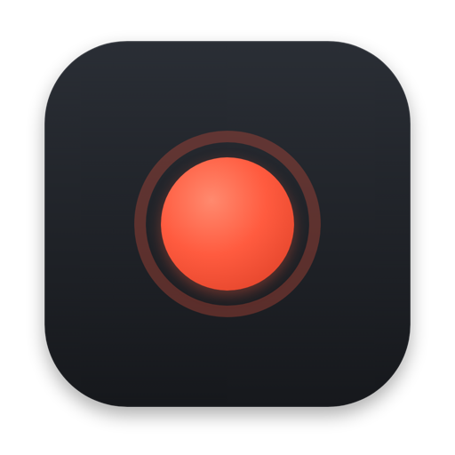
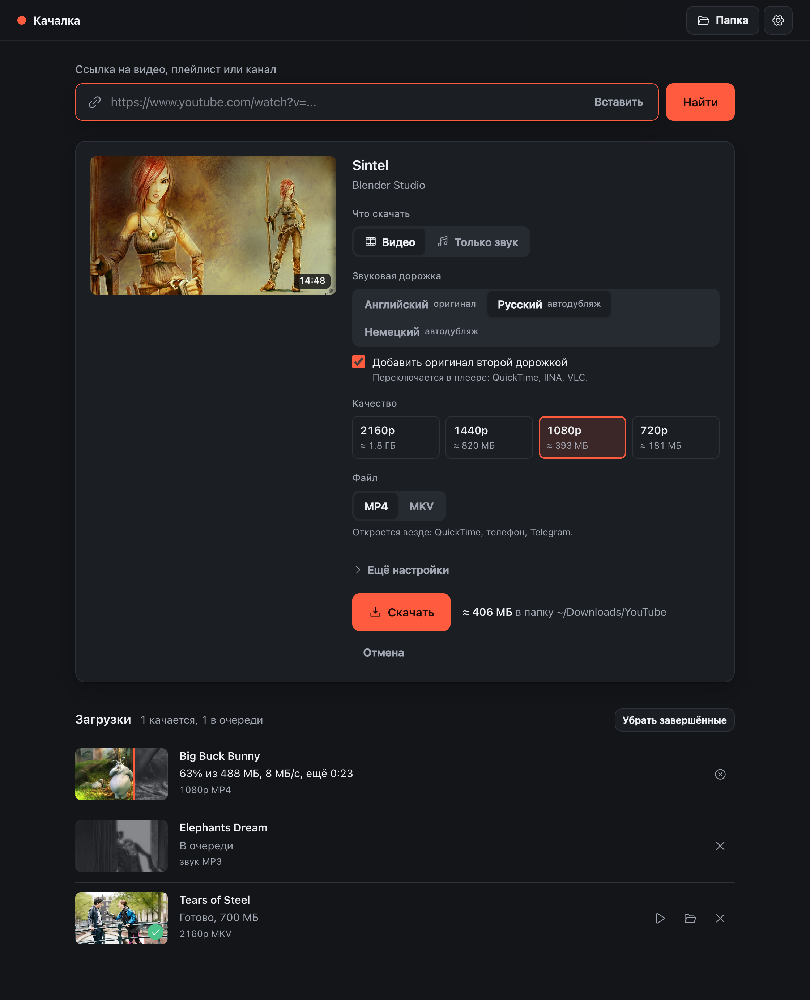
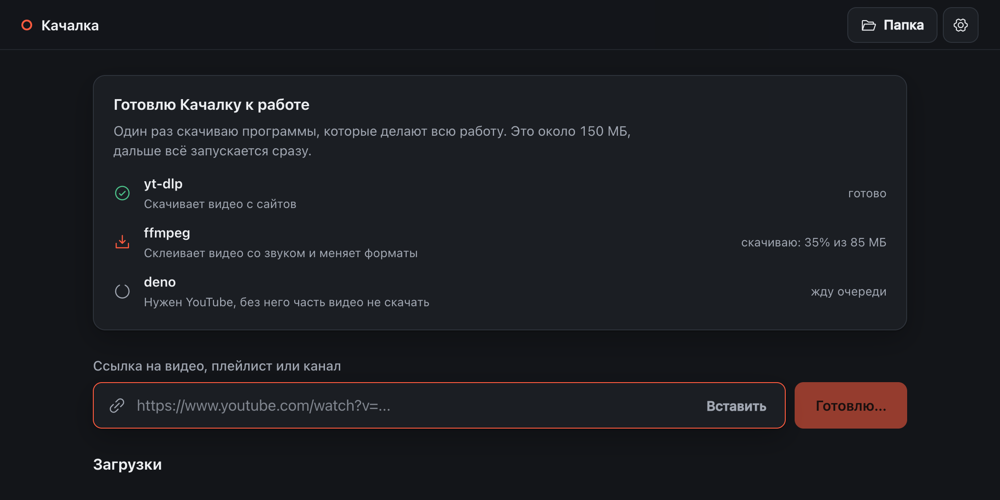
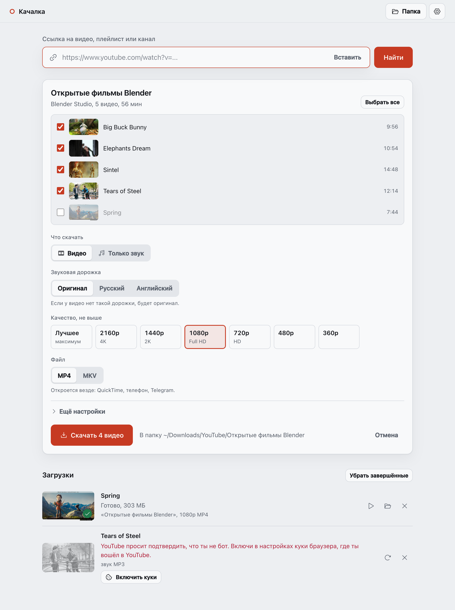

<p align="center">
  
</p>

<h1 align="center">Качалка</h1>

<p align="center">
  Простое приложение для Mac и Windows: скачивает видео и музыку с YouTube и ещё с тысячи сайтов.<br>
  Вставил ссылку, выбрал качество, нажал «Скачать».
</p>

<p align="center">
  <a href="https://github.com/vldvr/kachalka/releases/latest"><b>Скачать последнюю версию</b></a>
</p>



## Скачать

Открой страницу [последней версии](https://github.com/vldvr/kachalka/releases/latest) и возьми файл для своего компьютера:

| Компьютер | Файл |
|---|---|
| Mac с чипом Apple (M1, M2, M3, M4, M5) | `Kachalka-…-macOS-AppleSilicon.dmg` |
| Mac с процессором Intel | `Kachalka-…-macOS-Intel.dmg` |
| Windows 10 или 11 | `Kachalka-…-Windows-Setup.exe` |

Не знаешь, какой у тебя Mac? Нажми на яблоко в левом верхнем углу, выбери «Об этом Mac» и посмотри строку «Чип» или «Процессор».

Для Windows есть ещё `…-Windows-portable.zip`: его можно распаковать куда угодно и запускать без установки.

## Установка на Mac

1. Открой скачанный `.dmg` и перетащи Качалку в папку «Программы».
2. Запусти Качалку из «Программ». macOS скажет, что не может проверить разработчика, и не откроет её. Это нормально: у проекта нет платного сертификата Apple, поэтому система не знает, кто автор.
3. Открой «Системные настройки», раздел «Конфиденциальность и безопасность», пролистай вниз и нажми «Всё равно открыть» рядом с сообщением о Качалке. Подтверди паролем от Mac.

Это нужно сделать один раз. Дальше Качалка открывается как обычная программа, её можно закрепить в Dock.

## Установка на Windows

1. Запусти скачанный `Kachalka-…-Windows-Setup.exe`.
2. Если появится синее окно «Windows защитила ваш компьютер», нажми «Подробнее», а потом «Выполнить в любом случае». Причина та же, что на Mac: у проекта нет платной цифровой подписи.
3. Нажимай «Далее». Пароль администратора не нужен: Качалка ставится только для тебя. Ярлык появится в меню «Пуск».

Удалить её можно как любую программу: «Параметры», «Приложения», «Качалка», «Удалить».

## Первый запуск

При первом запуске Качалка сама скачивает программы, которые делают всю работу: [yt-dlp](https://github.com/yt-dlp/yt-dlp), [FFmpeg](https://ffmpeg.org) и [Deno](https://deno.com). Это около 150 МБ, нужен интернет. Всё берётся с официальных страниц проектов и сверяется по контрольным суммам. Потом Качалка запускается сразу.



## Как пользоваться

1. Скопируй ссылку на видео, плейлист или канал в браузере.
2. Вернись в Качалку и нажми <kbd>⌘</kbd> <kbd>V</kbd> на Mac или <kbd>Ctrl</kbd> <kbd>V</kbd> в Windows. Ссылку можно и перетащить прямо в окно.
3. Выбери, что скачать, и нажми «Скачать».

Файлы складываются в «Загрузки», в папку «YouTube». Её можно поменять в настройках (шестерёнка справа вверху).

## Что умеет

- **Видео** в MP4, который откроется где угодно, или в MKV с самыми современными кодеками. Для каждого качества видно, сколько примерно займёт файл.
- **Только звук** в MP3, M4A или Opus.
- **Звуковая дорожка.** Если у видео есть дубляж, в том числе автоматический от YouTube, можно выбрать язык. Можно положить в файл сразу две дорожки: перевод и оригинал.
- **Плейлисты и каналы** целиком или выборочно. Файлы плейлиста складываются в отдельную папку и нумеруются.
- **Субтитры, обложка и главы** прямо внутри файла.
- **Без рекламных вставок**: вырезает спонсорские куски по базе [SponsorBlock](https://sponsor.ajay.app).
- **Только кусок** видео по времени, например с 1:30 до 4:00.
- **Очередь**: несколько загрузок сразу, остановленные и прерванные можно докачать.
- **Сама обновляет yt-dlp**: YouTube часто меняется, и старая версия перестаёт работать.



## Если YouTube пишет «подтвердите, что вы не бот»

YouTube так проверяет запросы с VPN и с адресов дата-центров. Помогают куки браузера, в котором ты вошёл в YouTube:

1. Открой настройки Качалки.
2. В пункте «Куки из браузера» выбери свой браузер.

На Mac для Chrome и похожих браузеров система спросит доступ к связке ключей. Нажимай «Разрешить», а не «Разрешить всегда»: второй вариант открывает куки и пароли браузера любой программе на компьютере. В Windows лучше всего работает Firefox: Chrome и Edge шифруют куки так, что их не прочитает никакая другая программа.

Куки никуда не уходят, кроме самого YouTube, и Качалка их не сохраняет. Спокойнее всего завести для этого отдельный аккаунт Google.

## Частые вопросы

**Где лежат настройки и история?**
На Mac в `~/Library/Application Support/Kachalka`, в Windows в `%LOCALAPPDATA%\Kachalka`. Там же скачанные yt-dlp, ffmpeg и deno. Если удалить эту папку, Качалка начнёт с чистого листа.

**Качалка что-то отправляет обо мне?**
Нет. Сеть нужна только для скачивания видео и обновления yt-dlp. Сервер Качалки работает на твоём компьютере и доступен только ему.

**В Windows вместо окна открылся браузер.**
Окну Качалки нужен компонент Microsoft WebView2. В Windows 10 и 11 он обычно уже есть. Если его нет, Качалка работает во вкладке браузера, всё остальное так же. Поставить WebView2 можно [с сайта Microsoft](https://developer.microsoft.com/microsoft-edge/webview2/).

**Что-то перестало качаться.**
Открой настройки и нажми «Обновить yt-dlp». Если не помогло, [напиши о проблеме](https://github.com/vldvr/kachalka/issues/new): приложи ссылку и текст ошибки.

**Можно ли так скачивать всё подряд?**
Качалка просто инструмент. Скачивай то, на что у тебя есть права: свои видео, ролики под свободными лицензиями, записи для личного просмотра там, где это разрешено. Уважай авторов и правила сайтов.

## Для разработчиков

Качалка написана на Python без внешних зависимостей для логики. Окно рисует [pywebview](https://pywebview.flowrl.com): WKWebView на macOS и WebView2 на Windows. Интерфейс сделан на HTML, CSS и JavaScript без фреймворков. yt-dlp, ffmpeg и deno запускаются отдельными программами.

```bash
git clone https://github.com/vldvr/kachalka.git
cd kachalka
python3 -m venv .venv
source .venv/bin/activate
pip install -e ".[dev]"
python -m kachalka
```

Полезные флаги: `--browser` открывает интерфейс в браузере, `--headless` поднимает только сервер, `--own-tools` скачивает свои копии yt-dlp и ffmpeg даже при наличии системных, `--data-dir` задаёт отдельную папку для настроек. На Linux Качалка работает из исходников: окно требует GTK или Qt для pywebview, а с `--browser` обходится без них.

```bash
python -m pytest                      # быстрые тесты без сети
python tests/smoke.py --own-tools     # полный путь нового пользователя: компоненты, превью, загрузки
```

Сборка: `bash packaging/macos/build.sh` на Mac даёт `.app` и `.dmg`; на Windows `pyinstaller packaging/kachalka.spec` и `iscc packaging\windows\kachalka.iss`. Релиз собирает GitHub Actions: достаточно отправить тег `vX.Y.Z`, и через несколько минут установщики появятся на странице релиза.

```
kachalka/
  app.py       запуск, окно, один экземпляр
  server.py    локальный HTTP API для окна
  jobs.py      очередь и разбор прогресса yt-dlp
  ytdlp.py     превью, дорожки, сборка команды, понятные ошибки
  tools.py     поиск и установка yt-dlp, ffmpeg, deno
  system.py    всё, что отличается в macOS, Windows и Linux
  web/         интерфейс
packaging/     PyInstaller, установщик Windows, образ macOS, иконки
tests/         тесты
```

## Лицензии и благодарности

Качалка распространяется по лицензии [MIT](LICENSE).

Работу делают [yt-dlp](https://github.com/yt-dlp/yt-dlp) (Unlicense), [FFmpeg](https://ffmpeg.org) (сборки [yt-dlp/FFmpeg-Builds](https://github.com/yt-dlp/FFmpeg-Builds) для Windows и Linux и [Martin Riedl](https://ffmpeg.martin-riedl.de) для macOS, GPL) и [Deno](https://deno.com) (MIT). Качалка их не перепаковывает, а скачивает при первом запуске с официальных страниц. Окно на [pywebview](https://github.com/r0x0r/pywebview) (BSD), иконки [Phosphor](https://phosphoricons.com) (MIT).

Кадры на скриншотах: Big Buck Bunny, Elephants Dream, Sintel, Tears of Steel © Blender Foundation, [CC BY](https://creativecommons.org/licenses/by/3.0/); Spring, CC0. Источник: Wikimedia Commons.
